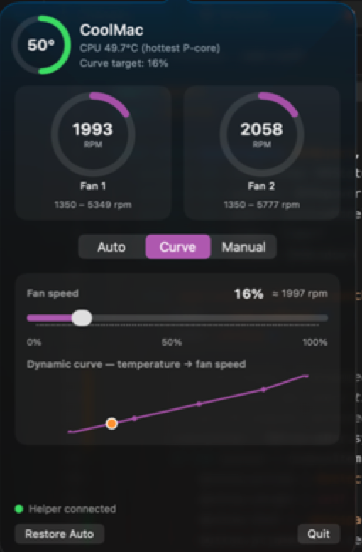
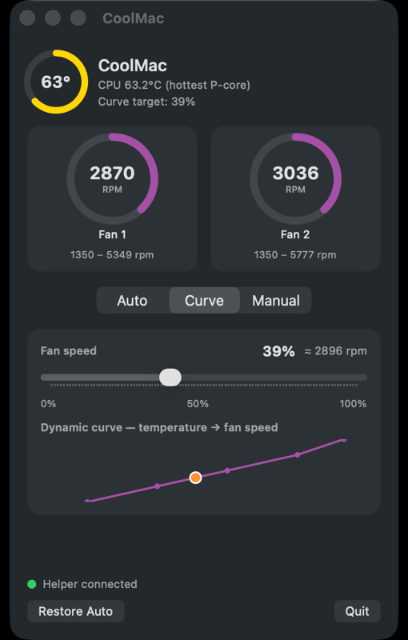

<div align="center">

# CoolMac

**Free, open-source fan control for Apple Silicon Macs — with a dynamic, temperature-based fan curve.**





</div>

---

## Why?

Commercial fan-control apps put automatic, temperature-based fan curves
behind a paywall. CoolMac is a clean-room, MIT-licensed implementation
built from the publicly documented AppleSMC interface — the same public
SMC key interface used by long-standing open-source projects. No
proprietary code, no license checks, no telemetry. Just your fans,
under your control.

## Features

- 🌡️ **Dynamic fan curve** — fan speed is interpolated smoothly from CPU
  temperature (40 °C → 0%, 55 °C → 25%, 70 °C → 50%, 85 °C → 75%, 95 °C → 100%),
  with a live chart showing where you are on the curve.
- ✏️ **Editable curve points** — drag the chart dots (vertically for %,
  horizontally for °C, clamped between neighbours). Points persist
  across launches; "Reset curve" in the ⚙️ menu restores the defaults.
- 🎛️ **Presets** — Silent (gentle curve, max 70%), Balanced (default
  curve) and Full blast (Manual 100%). The active preset stays
  highlighted until you edit the curve or drag a slider.
- 🎚️ **Manual slider** — set a fixed fan speed from 0–100% (with the
  equivalent RPM shown). Dragging the slider in Curve mode switches to
  Manual, just like you'd expect.
- 👯 **Per-fan control** — turn off "Link fans" to set Fan 1 and Fan 2
  independently in Manual mode (`SET2` to the helper). In Curve mode
  both fans share the one curve.
- 🚀 **Launch at login** — optional per-user LaunchAgent
  (`~/Library/LaunchAgents/com.github.d4vz.coolmac.plist`), no admin
  needed; only available when running from the `CoolMac.app` bundle.
- 🤖 **Automatic mode** — hand control back to macOS at any time.
- 📊 **Menu-bar popover** — hottest P-core temperature, per-fan RPM
  gauges with min/max ranges, always one click away. Link fans
  (default on), launch at login, restore-Auto and curve reset live
  under the ⚙️ settings menu. The status item itself shows just the
  temperature at a fixed width, so the popover anchors to the exact
  same spot on every click.
- 🛡️ **Safety first** — a privileged helper daemon owns all SMC writes.
  If the app crashes or is killed, the helper's watchdog reverts the
  fans to system Auto within 15 seconds. Fan speeds are always clamped
  to each fan's hardware min/max.

## Tested on

| Machine | Chip | Fans | Result |
|---|---|---|---|
| MacBook Pro (Mac17,8) | Apple M5 Pro | 2 (1,350–5,349 / 5,777 RPM) | ✅ Full read + control |

Other Apple Silicon Macs with SMC fan keys (`FNum`, `F*Ac`, `F*Tg`,
`F*md`) should work — please
[open an issue](https://github.com/d4vz/coolmac/issues) with your
`coolmac-probe` output either way.

## Install

> ⚠️ Quit any other fan-control app first — two controllers writing the
> same SMC keys will fight over your fans.

### 1. Build the app (no Xcode required, just Command Line Tools)

```bash
git clone https://github.com/d4vz/coolmac.git
cd coolmac
scripts/build-app.sh        # → dist/CoolMac.app (ad-hoc signed)
open dist/CoolMac.app
```

### 2. Install the privileged helper

Fan writes require root (verified: user-level SMC writes are denied on
Apple Silicon). CoolMac ships a tiny helper daemon for that:

```bash
dist/CoolMac.app/Contents/Resources/install-helper.sh
# or, from the repo:
scripts/install-helper.sh
```

macOS will ask for your admin password. The helper:

- runs as a root LaunchDaemon (`com.coolmac.helper`),
- listens only on `/var/run/coolmac.sock` (root:admin, `0660`; only
  root or the logged-in console user may connect),
- understands five commands: `PING`, `AUTO`, `SET <0-100>`,
  `SET2 <p1> [<p2> …]` (per-fan percents; extras ignored, missing fans
  repeat the last value), `STATUS`. Older helpers reject `SET2` with
  `ERR`, and the app falls back to a single `SET`,
- **reverts fans to Auto if the app goes silent for 15 s.**

Remove it any time with `scripts/uninstall-helper.sh` — it restores
Auto before uninstalling.

## How it works

CoolMac talks to the AppleSMC user client via IOKit. Keys used
(enumerated live on the test machine: 3,626 keys):

| Key pattern | Meaning |
|---|---|
| `FNum` | Number of fans |
| `F<i>Ac` | Fan *i* actual RPM (`flt`) |
| `F<i>Tg` | Fan *i* target RPM (`flt`) — write |
| `F<i>Mn` / `F<i>Mx` | Fan *i* hardware min / max RPM |
| `F<i>md` | Fan *i* mode: `0` = system auto, `1` = manual — write |
| `Tp*` | P-core temperatures (`flt`) — hottest one drives the curve |

Check what your own Mac exposes with the bundled, read-only probe:

```bash
swift run coolmac-probe
```

## Project structure

```
coolmac/
├── Sources/
│   ├── SMC/            # Public AppleSMC IOKit client (read/write, key enumeration)
│   ├── CoolMacShared/  # App ↔ helper Unix-socket protocol
│   ├── CoolMac/        # SwiftUI menu-bar app (popover + --window / --show-popover)
│   ├── CoolMacHelper/  # Root helper daemon (SMC writes + watchdog)
│   └── CoolMacProbe/   # Read-only CLI that dumps fan/temperature keys
├── App/                # Info.plist + bundled helper installer
├── LaunchDaemon/       # com.coolmac.helper.plist
├── scripts/            # build-app.sh, install/uninstall-helper.sh, make-icon.swift
└── docs/screenshots/
```

## Roadmap

- [x] Editable curve points (drag the dots on the chart)
- [x] Presets: Silent / Balanced / Full blast
- [x] Draggable per-fan control (unlink fans in Manual mode)
- [ ] Signed + notarized releases (Developer ID) — blocked: needs a paid Apple Developer ID
- [ ] `SMAppService` helper registration (no install script) — blocked: needs a full Xcode project + signing identity
- [x] Login item / launch at login

## Contributing

Issues and pull requests are welcome — see [CONTRIBUTING.md](CONTRIBUTING.md).
A `coolmac-probe` dump from an untested machine is one of the most
valuable contributions you can make.

## Disclaimer

CoolMac is an independent open-source project, not affiliated with
Apple, CrystalIdea (Macs Fan Control), or exelban (Stats) — though
Stats is excellent and was the inspiration for this repo's layout.
Controlling your fans overrides macOS thermal policy: use sane curves,
keep an eye on temperatures, and understand that you do so at your
own risk.

## License

[MIT](LICENSE) © 2026 Davi Orlandi
